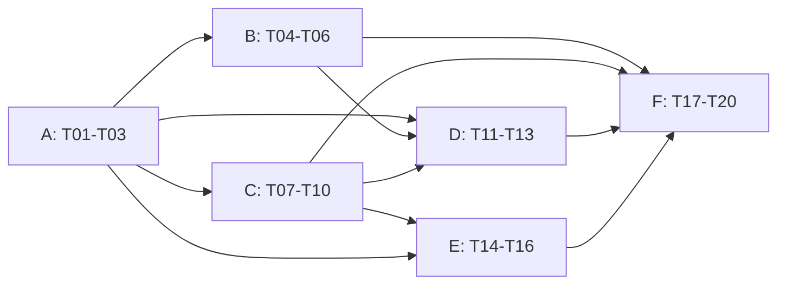

# v1.0 任务拆分

**状态（2026-10-28）**：6 个工作包、20 个任务，均未完成。[总任务 #8](https://github.com/infrafile/infrafile/issues/8)汇总进度。产品和技术决定见[完整方案](v1.0.md)，验收编号见[验收清单](v1.0-acceptance.md)。本文维护范围/依赖，GitHub 工作包 issue 维护勾选状态和证据，避免两处手动维护进度。

每个 T 编号是一个可独立审查的交付单元，默认一个实现 PR；必要时按“契约/实现”拆两个 PR，不能因此把验收遗失。实现负责人默认为项目维护 Agent，方案取舍与发布负责人为维护者；真实账号操作和使用方迁移由相应使用方负责人确认。外部独立试用者在 T17 记录，未落实前不称该项完成。

## 工作包和开发顺序

| 工作包 | 任务 | 交付结果 | 进入条件 |
| --- | --- | --- | --- |
| [A 契约与范围](https://github.com/infrafile/infrafile/issues/10) | T01–T03 | 能力、兼容、迁移边界可检查 | 可立即开始 |
| [B 接入与迁移](https://github.com/infrafile/infrafile/issues/11) | T04–T06 | 预检、可审阅导入、真实迁移演练 | 相应 A 任务完成 |
| [C 可信巡检](https://github.com/infrafile/infrafile/issues/12) | T07–T10 | 覆盖、问题身份/历史、持续运行接入 | T01/T02；T10 基线收集可先做 |
| [D 单用户工作台](https://github.com/infrafile/infrafile/issues/13) | T11–T13 | 安全只读 Web、三页面、共享台账编辑 | 契约后启动，编辑等待 B/C |
| [E Agent 受控流程](https://github.com/infrafile/infrafile/issues/14) | T14–T16 | 一致上下文、计划绑定/执行记录、端到端流程 | 读取与控制契约可分别推进 |
| [F 真实验收与发布](https://github.com/infrafile/infrafile/issues/15) | T17–T20 | 独立上手、长期运行、升级恢复、正式版 | 验收准备提前；关闭等待实现证据 |

工作包图表达最终交付依赖，具体开工按下面 T 级依赖；同一工作包内部允许并行。T17 可以在 CLI 接入完成后开始试用，T18 可在可信巡检完成后开始累计，不能等 UI 收尾才开始准备。

## A 契约与范围

### T01 能力矩阵与查询契约

- **依赖**：无。**影响**：`protocol/`、`internal/plugin`、`internal/observation`、CLI/MCP 描述、第一方插件文档。
- **交付**：按插件/服务/字段/动作描述登记、观测、比较、计划、执行、回读；复用 describe 的版本能力，在兼容前提下暴露 `capabilities`，冻结新增命令/字段命名。数据同时驱动各入口与文档，不建通用插件注册平台。
- **验收**：现有九个第一方插件都有显式边界；未知旧插件降为 unknown；TLS 不冒充证书清单，zone pause 不冒充单域名操作；unsupported 在远端调用前拒绝。对应 AT01。
- **完成证据**：能力夹具、CLI/MCP 一致性和旧插件握手结果、更新后的支持矩阵。

### T02 兼容与持久化版本策略

- **依赖**：T01 的字段草案；可同步设计。**影响**：`internal/ledger`、`snapshot`、`protocol`、`docs/json`、Schema、黄金测试、发布文档。
- **交付**：冻结公共 API 清单和兼容规则，确定新历史/事务记录格式、旧读取器行为、程序回退与数据恢复路径；定义新命令退出码，不改变 audit 的原退出码与 ok。
- **验收**：v0.3 数据、旧插件/MCP 调用仍可用；新数据遇旧版明确失败或走兼容导出；坏版本/重复键/超限/符号链接被拒绝。对应 AT02。
- **完成证据**：旧二进制回放、格式与兼容测试；标明哪些接口冻结，哪些仍为实验扩展。

### T03 使用方迁移范围与旧流程承接清单

通用清单与自有台账脱敏结论见[使用方范围与旧流程承接](../adoption.md)；私有源版本和证据引用由工作包 A issue 维护。

- **依赖**：无；退出依赖 T01。**影响**：使用方现有唯一运维台账/行动项，工具仓仅保留虚构模板与映射约束。
- **交付**：登记旧能力→新能力/继续保留的流程、数据源、负责人、验收证据、切换和恢复条件；选定本版实际纳管范围。梳理 SSH、采集、通知、证书、备份等调用者，但不要求全部重写。
- **验收**：每个被替换流程都有承接或明确保留；没有双权威编辑；私有投影和未知字段不算迁移完成。对应 AT03。
- **完成证据**：私有范围清单及版本引用、公开脱敏摘要。没有切换授权时可以完成设计，不能标正式切换完成。

## B 接入与迁移

### T04 分层预检 doctor

- **依赖**：T01、T02。**影响**：`internal/secret`、`validate`、`plugin`、CLI，凭据和上手文档。
- **交付**：离线检查插件引用、布局、能力和所需权限；在线显式选择实例，限时/限量只读验证连接，分类缺引用、网络、认证、权限/功能、未知。
- **验收**：默认不解密/联网；在线不改 state/inventory；403 不变空清单；无法确定错误原因时不伪造分类；输出不含值、请求签名或原始敏感错误。对应 AT04。
- **完成证据**：env/SOPS、取消/超时、多实例隔离、错误反射测试与专用账号只读结果。

### T05 可重复的导入与审阅草稿

- **依赖**：T01、T02。**影响**：`internal/importer`、`observation`、`validate`、CLI、导入契约。
- **交付**：稳定来源/自然身份与候选清单；记录已存在、冲突、缺口和跳过原因；允许校验经过人工编辑的候选。维持只建不覆盖，发布复用 T13 的共享变更入口；本任务先交付预览和候选验证。
- **验收**：同源重复运行无重复资产；归档不复活；同键异值阻断；源版本变化可发现；缺失日期/ID 不补造；无效候选不发布。对应 AT05。
- **完成证据**：SSH/state 直接调用者回归、虚构迁移夹具、草稿修改/冲突/重复导入测试。

### T06 真实数据映射与迁移演练

- **依赖**：T03、T05；正式写入候选通过 T13。**影响**：使用方仓库的映射工具、现有行动项和私有验收目录。
- **交付**：可重复的映射脚本、源 manifest、逐字段缺口、语义差异和恢复演练；替代临时手改投影流程。权威仓库位置不变，兼容旧工具的读取方式须明确。
- **验收**：两次生成同结果；源发生变化必须重算；跨范围引用和密文相对路径有效；恢复不覆盖后续用户修改；所有缺口有修复/保留/有期限例外的处理。对应 AT06。
- **完成证据**：隔离副本中的迁移/回退记录与哈希、真实缺口处置引用。正式切换由 T18 记录，不在本任务顺带操作生产。

## C 可信巡检

### T07 执行、覆盖、风险三维报告

- **依赖**：T01、T02。**影响**：`internal/audit`、`observation`、`snapshot`、CLI/MCP 只读结果。
- **交付**：`inspect` 聚合选定资产关系和各检查项状态，明确应检分母、证据来源/时间/TTL、unknown 原因与 NA 复核信息；复用现有 audit 规则。
- **验收**：零 findings 但无新鲜覆盖时不能显示全绿；失败旧快照、未基线、缺关系、多账号和未配置检查独立可见；读取保持禁网/不写盘。对应 AT07。
- **完成证据**：分母与状态表夹具、CLI/MCP 一致性、文件哈希与禁网测试。

### T08 问题稳定标识与恢复规则

- **依赖**：T07。**影响**：`internal/audit`、`observation`、finding JSON 的兼容扩展、豁免和黄金测试。
- **交付**：各规则的 fingerprint 与版本；规则/目标/实例/服务/方面组成身份，消息/时间/值不组成身份；定义 open/recovered/out-of-scope 与 confirmed/clear/unknown、豁免的独立关系。
- **验收**：同问题换消息不重复，不同账号/方面不合并；失败/过期/范围缩小/豁免不恢复；恢复后复发保留同问题历史。对应 AT08。
- **完成证据**：逐规则身份与完整状态转换表、边界回归测试。

### T09 问题历史的显式推进和变化输出

- **依赖**：T02、T08。**影响**：现有状态存取工具、CLI `findings refresh`、只读历史查询。
- **交付**：锁内固定输入、版本化历史、first_seen/last_confirmed/last_checked/recovered_at、变化输出及有界保留/导出。audit/inspect 不隐式更新历史。
- **验收**：重复运行幂等；输入变化和并发不能覆盖旧结果；损坏/磁盘失败/进程中断不丢活动问题；单纯证据过期产生 unknown 而非 recovered。对应 AT09。
- **完成证据**：故障注入、并发/幂等、保留上限与读取兼容测试；保留策略实测依据。

### T10 持续运行与 v0.3 接入收尾

- **依赖**：基线收集可立即开始；最终接入依赖 T04、T07、T09。**影响**：使用方现有调度、只读 CI、MCP 客户端和监控集成。
- **交付**：沿用现有 scheduler，串接有界采集、离线检查、显式历史刷新、变化通知；独立漏跑观察；桌面 MCP 实际加载、真实定时触发、远端离线 CI 与监控通知证据。旧 [issue #2](https://github.com/infrafile/infrafile/issues/2) 保持自己的完成条件。
- **验收**：未执行不报成功；403/漏跑/证据过期可见；未变化静默；通知失败单列且不丢问题；客户端重新加载后的真实工具发现与调用。对应 AT10。
- **完成证据**：私有真实执行回执、定时/漏跑/通知送达记录及公开脱敏摘要。已有 Gatus 集成若替换为使用方现有系统，必须记录范围调整后才可关闭原条目。

## D 单用户工作台

### T11 serve、认证与只读 API

- **依赖**：T01、T02；可先于问题历史 UI。**影响**：新 HTTP/模板层、CLI serve、读取服务、分发嵌入文件。
- **交付**：单仓单用户、回环默认、配对/会话及撤销、严格 Host/Origin/CSRF、请求限额、明确的远程 HTTPS 代理配置；只读 API 复用领域逻辑。
- **验收**：未登录/过期会话拒绝；跨站请求、恶意 Host、伪造代理头、路径穿越、符号链接和 HTML 注入被拒绝或转义；二进制独立启动，查询不解密。对应 AT11。
- **完成证据**：HTTP/会话安全测试、打包二进制启动、浏览器实际登录/退出/失效检查。

### T12 资产、巡检、变更三个页面

- **依赖**：T07、T09、T11；变更记录卡片等待 T15。**影响**：Web 模板/静态文件、共享 inspect 和能力接口。
- **交付**：资产搜索/关系/desired-observed、执行覆盖风险、问题历史、计划/回执列表；空态/失败/unknown/过期证据明确。保留变更详情的 CLI 执行入口说明。
- **验收**：与 CLI 对同输入结果一致；浏览器完成查资产→看证据→定位问题→看变更流程；键盘、标签、窄屏和无障碍状态文本可用。对应 AT12。
- **完成证据**：虚构数据截图、实际浏览器流程、页面状态测试；不以仅构建通过代替 UI 验收。

### T13 共享台账变更与 Git 提交

- **依赖**：T02、T05；Web 接线依赖 T11。**影响**：共享编辑逻辑、ledger/validate/importer、CLI change、Web 保存、事务恢复文件。
- **交付**：候选预览、完整仓库验证、HEAD/内容基准、写锁、干净树检查、仅本次变更的 Git 提交和失败恢复；支持创建、更新、归档及同次引用调整。
- **验收**：双会话、外部编辑、脏树、提交钩子失败、I/O 中断、多文件半写和中途重启均不覆盖用户内容；无效外键/秘密拒绝；同一流程处理人工修改的导入草稿；不自动 push。对应 AT13。
- **完成证据**：临时 Git 仓故障与并发测试、CLI/Web diff 一致性、恢复演练；不能用绕过 hooks 或 reset 用户工作解决失败。

## E Agent 受控流程

### T14 Agent 能力与证据上下文

- **依赖**：T01、T07、T09。**影响**：`cmd/infrafile/mcp.go`、共享 inspect、`internal/agent` 指南、MCP/CLI 契约。
- **交付**：复用 T01 已交付的能力 CLI/MCP 入口，新增巡检/上下文只读 MCP 入口；按 key/labels 返回限定资产和直接关系、证据时间、覆盖缺口、问题历史及下一步允许动作。保留原七个工具。
- **验收**：不接受任意路径/地址/命令；结果有界；Account 秘密省略；取消/超时有效；同输入 CLI/Web/MCP 一致；台账中的指令文本不会触发操作。对应 AT14。
- **完成证据**：真实 stdio 子进程测试、客户端实际发现与调用、内嵌指南与示例更新。

### T15 计划绑定、时效与执行回执

- **依赖**：T01、T02。**影响**：`internal/control`、CLI plan/apply、计划/执行 JSON、Web 只读变更记录。
- **交付**：所审阅计划摘要、时效检查、授权来源引用、执行前持久记录与执行后结果；同摘要的本地互斥/重复保护。保留单动作与既有远端重读。
- **验收**：不同摘要/过期/目标或配置变化拒绝；记录落盘失败不写远端；写后崩溃/回读失败保持 uncertain；重试先核实，无盲写；不宣称审批身份认证、exactly-once 或原子 CAS。对应 AT15。
- **完成证据**：单动作回放、取消/断电模拟、重复执行、回读 mismatch/uncertain 测试，旧计划兼容规则。

### T16 Agent 完整操作场景

- **依赖**：T04、T13、T14、T15。**影响**：使用指南、可重复验收脚本、专用真实验收资产。
- **交付**：两条场景：Agent 提议台账修改→审阅/授权→提交；Agent 查询/取证→Cloudflare 专用 zone 计划→授权→CLI 执行→回读→恢复原状态。MCP 仍不写。
- **验收**：执行范围与授权相符；审阅后变更拒绝；失败停止盲重试；回读与专用测试入口证据分开；记录客户端工具轨迹和目标恢复结果。对应 AT16。
- **完成证据**：离线失败夹具 + 使用方另行安排的真实单动作记录；没有可用专用资产/授权时保持未完成，不能以模拟写验收替代。

## F 真实验收与发布

### T17 外部用户独立接入

- **依赖**：T04、T05；最终依赖 T11–T16 和 T20 的 RC 产物。准备可在 A 后开始。
- **交付**：公开教程、支持组合、常见失败修复路径；非维护者在干净 Linux amd64 环境独立接入真实 Cloudflare 只读范围，完成 Web/MCP、重复采集和一次受控操作流程；macOS arm64 做独立安装回归。
- **验收**：不注入维护者私有配置；帮助需求均记录并改进文档/产品后重走受影响步骤；不要求试用者交出凭据。对应 AT17。
- **完成证据**：试用者确认、环境/版本/步骤/帮助记录、脱敏结果；找不到试用者时明确未验收。

### T18 自有台账长期运行与分范围切换

- **依赖**：T03、T06、T10；正式编辑切换依赖 T13，完整场景依赖 T16。
- **交付**：选定真实范围连续 14 个日历日、至少两次每周完整采集的证据；覆盖成功、失败、恢复、漏跑、过期；按 T03 清单完成获授权范围的正式接入/切换及恢复验证。
- **验收**：100% 应运行项可对应成功/失败/漏跑记录；没有静默漏跑、误恢复和双权威编辑；确认范围内无未处置阻断项。故障可在隔离副本或专用实例注入，不破坏业务制造样本。对应 AT18。
- **完成证据**：每日汇总、独立漏跑检测、真实问题变化、迁移与回退引用。时间窗口不可用快速循环替代；语义变化后重验受影响窗口。

### T19 升级、数据恢复与兼容回退

- **依赖**：T02、T06、T09、T13、T15 和 T20 的 RC 产物。
- **交付**：v0.3→RC 升级；新格式兼容导出或版本备份恢复后回退；观测/历史损坏、编辑中断恢复；密钥与密文可恢复性验证。
- **验收**：旧台账/调用者继续可读；不覆盖升级后新增修改；旧程序拒绝的新格式有明确恢复路径；恢复旧历史不能冒充新鲜观测；回退后关键 CLI/MCP/导入流程仍可用。对应 AT19。
- **完成证据**：两个正式运行平台的真实二进制结果、文件哈希、保留的原始版本/恢复点与失败示例。

### T20 RC、接口冻结与 v1.0 发布

- **依赖**：分两个阶段。RC 构建在待验功能具备、相关检查通过后开始，提供 T17/T19 所需候选产物；正式发布等待 T01–T19 均有完成证据。条件支持项按支持矩阵明确保留，不能豁免三个核心目标。
- **交付**：先冻结候选契约并生成可追溯 commit 的 RC 归档供验收；再依据验收修订、冻结公共契约与支持矩阵，完成发布说明/升级指南、最终提交 CI、签名产物、Homebrew 和原生 smoke。沿用现有发布流程，修正版本示例时核对真实 tag，不机械替换历史记录。
- **验收**：AT01–AT19 均有结论且核心门槛通过；无未解决的数据丢失/秘密泄露/误恢复/越授权范围问题；最终提交与实际发布构建一致。对应 AT20。
- **完成证据**：RC 检查表、最终 commit/CI/tag、签名与归档校验、安装/升级/别名 smoke、已知限制清单。

## 执行约定

1. 先做 T01/T02/T03；T04/T05/T07/T11/T15 在各自契约稳定后并行，避免多个 PR 同时改同一共享契约。
2. 每个实现 PR 写明 T 编号、直接调用者、测试/夹具/Schema/指南影响和证据。涉及私有仓库的任务只公开脱敏摘要，不附真实快照、账号标识、IP 或凭据。
3. 每次 PR 交付前按项目约定做相关测试及一次完整 preflight；复用未变输入的结果。合并以最终提交 CI 为准；发布另走 AT20。纯文档不因此重跑业务测试。
4. 工作包关闭需要其中每个任务有证据链接。T10 不自动关闭 issue #2；原验收项逐项核对后再关闭。F 未完成时不把“代码合并”写成“v1.0 已完成”。
5. 用户数据切换、真实云写、通知送达演练和发布执行分别记录适用授权。本规划任务只创建方案和任务，不执行这些动作。
