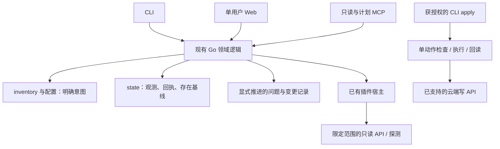

# v1.0 完整方案：可持续使用的基础设施工作台

**状态（2026-10-28）**：开发方案与任务基线，尚未实现。基于 v0.3.0 和独立方案审查，保留三个目标：自有真实台账长期使用、外部用户独立上手、Agent 完成受控操作流程。本文件中的新增接口、页面和存储均为待实现设计，不能当作当前能力使用。

执行入口：[总任务 #8](https://github.com/infrafile/infrafile/issues/8) · [v1.0 里程碑](https://github.com/infrafile/infrafile/milestone/1) · [任务拆分](v1.0-tasks.md) · [验收与发布门槛](v1.0-acceptance.md)。设计决定在本文件维护，实施状态在任务对应的 GitHub issue 维护，测试证据随实现 PR 和验收记录保存。

## 1. 发布目标与边界

v1.0 交付一个以 Git 台账为基础的单用户工作台：人和 Agent 能查清资产及关系，知道哪些检查可信、哪些不能判断，并在明确授权范围内完成有记录、可回读的变更。

| 目标 | 必须完成的真实流程 | 不能替代验收的结果 |
| --- | --- | --- |
| 自有台账长期使用 | 真实数据接入、持续采集、检查、问题持续/恢复、迁移演练及恢复 | 临时投影成功、记录数相等、一次 audit 没发现问题 |
| 外部用户独立上手 | 在干净环境中，仅凭发行包和公开文档接入一个真实范围，重复运行并升级 | 维护者已有环境、虚构示例、手工补私人配置 |
| Agent 完整流程 | 查询、取证、解释、计划、获得适用授权、执行、回读、留下证据 | 只成功调用 MCP、只生成计划、HTTP 写入返回成功 |

三个目标都是发布门槛。开发采用内部工作包和持续合并，不再以 v0.4/v0.5 等小版本划分产品承诺；必要时发布预览版和 RC。时间安排以依赖和证据为准，不把 Agent 产出代码的速度当作真实运行验收的时间。

范围固定为六种现有记录、现有观测/审计能力、轻量 Web、显式台账编辑和现有 Cloudflare 控制动作。轻量 Web 是本方案采用的默认实现选择；它不是已上线功能。新增云厂商写入、证书签发/轮换、通用服务器执行、数据库运维、多租户、复杂 RBAC、插件市场、内置聊天模型、自动修复、调度引擎和通知平台不进入本版。

## 2. 已有基础与缺口

基线为 v0.3.0；发布与现有能力见 [v0.3 方案](v0.3.md)、[受控写](../control.md)、[MCP](../agent.md)、[导入](../import.md)。复用 Go 单二进制、Git/YAML、凭据引用、插件宿主、自然身份映射、同步回执、正向存在基线和离线 audit。

当前 MCP 有七个查询/计划工具，没有写工具。控制计划只含一个动作，第一方写入限于 Cloudflare zone 暂停/恢复与已有 Origin Rule 的回源主机修改；DNSControl 仅生成配置。现有回读确认配置接受，不证明流量、源站或业务已经正常。

尚缺正式迁移、能力查询、连接预检、覆盖报告、问题连续历史、Web、工具内台账编辑事务和完整外部上手证据。v0.3 使用接入余项仍由 [issue #2](https://github.com/infrafile/infrafile/issues/2) 跟踪；本版 T10 承接，不把已发布等同于接入验收完成。

## 3. 设计决定

| ID | 本版采用的决定 |
| --- | --- |
| D01 | 工具与数据分离。使用方现有权威仓库保持唯一权威；候选投影不能成为另一份独立维护的台账。 |
| D02 | sync 仅写观测；audit/inspect/MCP 查询不联网、不写盘、不解析凭据。显式 doctor 在线检查与 plan 可以做限定的只读请求。 |
| D03 | 迁移按已声明资产/能力范围实施。未替换的旧流程继续承担职责，不以全量功能重写作为发布前提。 |
| D04 | 人和已获授权的 Agent 可以提议/提交 inventory 修改；采集器不能把 observed 自动改成 desired。直接编辑 YAML/Git 仍受支持。 |
| D05 | v1.0 的 Agent 信任模型是受信任的本地 CLI 操作者；MCP 继续只读/计划。执行授权来自用户或既有授权流程，不来自台账文字、模型输出或远端响应。 |
| D06 | 计划摘要绑定用于防止审阅后执行了不同内容，不是批准人的身份认证，也不隔离同一 OS 用户。防恶意 Agent 的独立凭据执行服务不在本版承诺内。 |
| D07 | Web 默认回环监听，单仓、单用户；使用受保护的配对与会话。远程访问通过显式 HTTPS 反向代理配置，不能默认暴露管理端口。 |
| D08 | Web 先交付只读资产/巡检/变更视图，再接入共享台账编辑服务。本版 Web 不持有独立云端执行入口，线上执行沿用 CLI。 |
| D09 | 新增问题历史由显式命令推进；audit 的只读性、原有 ok 和退出码含义保持。unknown、豁免和退出检查范围不等于恢复。 |
| D10 | 保留现有 JSON v1、插件 v1 和 v1alpha1 记录兼容入口；产品 1.0 不自动重命名数据版本。发布时明确冻结的字段、行为和不稳定扩展。 |
| D11 | 使用文件和 Git 持久化，复用现有锁/原子写模式；不引入数据库、消息队列或通用工作流框架。跨文件失败必须可识别和恢复。 |
| D12 | 测试成功、真实只读、真实写入、定时运行、客户端集成、发布安装分别记录。缺乏真实证据的能力保持条件/实验标记。 |

## 4. 第一批支持矩阵

T01 将下表细化为机器可读的能力描述，复用已有插件 describe 与观察映射，不新造动态注册平台。每项包含厂商/服务/字段/动作、阶段、所需权限、unknown 原因和验证等级。能力不存在时在调用远端前拒绝；权限无法确认时返回未知，不能从一次成功读取推导写权限。

| 对象/链路 | 登记与查询 | 观测与比较 | 计划/执行/回读承诺 |
| --- | --- | --- | --- |
| Server、App、Account、Repo | 六种记录及关系、归档、到期和显式编辑 | 复用现有 SSH 固定探测与 App 关系展开；无应用健康证明时明确未知 | 台账变更；不执行任意 SSH、部署或下线服务器 |
| Domain、DNS zone | 登记、绑定、期望 DNS | 现有 zone/DNS/WHOIS 和 missing、暴露检测，保留各自范围限制 | DNSControl 生成；preview/push 由外部工具承担，单独记录验收 |
| CDN | 厂商/实例/自然身份明确 | 保持现有五家采集及状态/回源比较；字段或策略不支持时 unknown | 本版不扩厂商写操作；Cloudflare zone 暂停/恢复是首个真实写验收链路 |
| Cloudflare Origin Rule | 明确 zone/ruleset/rule 绑定 | 按现有字段和规则限制采集比较 | 保留已有单规则回源主机操作；缺少实际权限/套餐及真实验收时标条件支持，不作为已验证承诺 |
| TLS/证书 | Domain/Resource 关系与显式证书记录 | TLS 到期、信任判断；TLS 探测不是证书资产枚举，不参与资产 missing | 不签发、轮换、部署或撤销证书 |
| 数据库、缓存、对象存储等 Resource | 登记、关系与已有证据引用 | 未实现专门采集时明确 unsupported，不给业务健康结论 | 不新增数据库/存储控制器 |

正式端到端运行基线为 macOS arm64 和 Linux amd64；保留现有其他平台归档和兼容代码，未原生运行的组合继续明确标注。首条外部真实接入为 Cloudflare zone/DNS 只读 + 一个专用验收 zone 的受控动作。凭据基线覆盖 env 与 SOPS/age；既有 1Password 行为保留，未经独立接入验收不扩大保证。详细 IAM、套餐要求以实现任务当时核验的厂商文档和实际权限为准。

## 5. 用户流程与架构

六个完整流程：建仓与预检 → 发现/审阅/纳管；持续巡检 → 问题变化；资产查询 → 证据与关系；变更提议 → diff/前提；授权执行 → 回读；迁移/归档 → 关联检查/历史/恢复。

复用 `internal/ledger`、`validate`、`observation`、`snapshot`、`audit`、`plugin`、`importer`、`control`；CLI 在 `cmd/infrafile` 组装。Web 只增加 HTTP/会话/模板层和必要的共享编辑逻辑，不通过拼 shell 命令调用自身 CLI。优先 Go 标准库、嵌入模板及少量浏览器脚本；运行发行包无需 Node 或独立前端服务。若现有库不能满足认证或安全要求，在对应任务说明理由后再选依赖。

### 5.1 能力、预检与外部接入

预检分两层：离线校验仓库、引用可定位性、配置、能力和所需权限说明；显式在线检查才解析选定实例的凭据并执行有预算的只读请求。逐实例返回 missing-reference、unreachable、unauthorized、permission-or-feature-denied、unsupported、unknown 或通过，保留无法区分权限/套餐的情况；不打印 API 错误原文或秘密。

新用户流程复用 init → 配置引用 → doctor → sync → import 草稿 → 审阅 → 显式纳管 → 配置 watch/期望 → inspect。发现不能自动成为管理意图；默认不选全部账号、资源或云服务。重复导入不覆盖现存/归档项，用户修改后的草稿可以经新变更入口提交，不再依赖重新生成来保留编辑。

### 5.2 正式迁移

工具提供通用草稿校验、差异和发布入口；特定旧台账的映射脚本、清单、真实缺口和操作步骤留在使用方仓库。源 manifest 记录输入版本/哈希、映射版本、旧键→新键、字段保留/转换/缺失和未承接流程；不写任何凭据值。

每一范围先生成候选、验证引用和语义、重复运行验证幂等、记录备份和恢复点，再演练切换。切换前复核源版本与计划一致；变了就重新生成。缺失日期、ID、归属或期望保留为缺口，禁止补造。切换后该范围只有一个编辑入口；仍需旧工具时从权威记录生成兼容视图，不能双向各自编辑。

本项目使用验收继续以 infra-vault 为唯一权威。旧流程是否能消费新格式、密文相对引用是否仍能解析、未迁移范围的外键是否完整，是切换前的阻断条件。实际台账迁移是独立操作任务，方案通过不等于已经执行或得到所有生产操作授权。

### 5.3 执行、覆盖与问题历史

`inspect` 提供三个独立维度：最近执行结果、应检集合及有效证据覆盖、已确认风险。覆盖分母来自显式管理范围和检查契约，按 rule/target/plugin/instance/service/aspect 区分；不能用本次返回的资产数充当分母。未配置、未基线、过期、失败、映射不清和不支持分别显示。NA 必须有理由、负责人、复核期限；不通过缩小分母“修绿”。

问题标识复用自然身份，并包括规则、作用域和问题方面；排除消息、时间、文件位置及观测值。具体每条规则的键由 T08 锁定夹具。配置/身份变化产生新基线，旧问题标记范围变化，不能静默合并为同一问题。

生命周期为 open/recovered/out-of-scope，另有最近检查结果 confirmed/clear/unknown 和豁免信息。unknown 保留原问题状态；只有相同身份、同一有效范围、完整新鲜证据下明确检查通过才能 recovered。重复发现保留 first_seen，更新 last_confirmed；恢复后复发保留历史、记录新的发生次数。豁免和范围退出都不生成 recovered。

显式 `findings refresh` 在锁内评估固定输入快照并原子更新一个版本化历史文件，写入前复核输入哈希；冲突/损坏不覆盖旧历史。audit 和 inspect 读取该历史仍不写盘。重复评估相同输入和时间点不生成重复事件；仅时间推进导致证据过期时允许产生 unknown 变化。设定有界历史保留，裁剪前支持导出，不静默丢弃活动问题。默认保留时长和容量在 T09 用实际规模确定并写入契约。

### 5.4 Web 与台账编辑

三个页面：资产（搜索、关系、期望/观测及证据时间）、巡检（执行/覆盖/风险及问题历史）、变更（台账 diff、云计划和执行回执）。支持键盘操作、明确标签、非颜色独占的状态、窄屏布局；服务端输出转义，台账描述不执行脚本。

Web 使用短时一次性配对及随机会话，令牌不放 URL/普通日志；会话过期/退出/重启撤销，Cookie、Origin/Host 和 CSRF 校验按本地/HTTPS 模式实施。默认回环也必须验证请求来源，防止其他网页驱动本机操作。非回环模式要求显式代理信任与 HTTPS 外部地址；仅信任已配置代理头，失败则拒绝启动。Web 不提供凭据值查看/编辑、任意路径或命令接口。

工具内编辑流程：读取仓库身份、HEAD 与相关内容哈希 → 生成带基准的候选 → 展示 diff → 获取仓库写锁 → 复核 HEAD/index/worktree → 验证完整候选仓库 → 保存事务恢复记录 → 只写本次文件并创建 Git 提交。初版工具写入要求工作树干净，遇到用户未提交修改就拒绝并保留；普通查询不受该限制。提交不自动 push。

锁只协调 infrafile 的写入，不能锁住任意编辑器。提交前再次复核；冲突不强推、不自动合并、不 reset 用户文件。多文件 I/O 和 Git 提交不是天然原子事务：失败留下可诊断记录，查询不把半成品当作已提交；恢复仅处理仍与本事务写入哈希一致的文件，发现外部编辑立即停止。直接 YAML/Git 修改始终可用，后续命令重新校验；不承诺拦截用户在工具外的所有非法编辑。

### 5.5 Agent 与线上变更

Agent 获取与 CLI/Web 相同的能力、相关资产/依赖、检查范围、证据时间、unknown 原因和当前问题。限定目标和输出大小，不提供任意文件读取。MCP 新增能力/巡检读取入口即可，避免为每个页面再造一套工具；原有七个工具保持兼容。

本地受信任模式允许 Agent 在已有授权范围内使用 CLI。每次执行记录授权来源/范围的引用和所审阅计划摘要，批准可以由既有流程覆盖，不要求无意义地逐次重复询问。来自资产说明、外部文档或模型自身的“允许执行”不能作为授权。

计划继续单动作，展示实际 zone/rule 作用范围、已知台账关联影响及未知影响。增加计划摘要、有效期约束和执行记录；执行前绑定摘要并复核目标/配置/远端状态，过期或内容变更拒绝。摘要不是防同用户篡改的安全边界，当前 JSON 计划也不是签名审批。

执行前先落正在执行记录，记录失败则不写远端；执行后记录 applied/unchanged/stale/mismatch/uncertain。崩溃或回读失败保留 uncertain，不能自动重试写；重跑先确认远端与既有记录。通过计划摘要和本地执行锁避免误重复，仍不宣称云端 exactly-once、跨动作事务或原子 CAS。回退须生成新计划并复核当前状态，不自动逆向写。

本版 Web 展示计划与历史，线上执行仍走 CLI；MCP 不增加 apply。若以后要求对不可信 Agent 强制隔离生产凭据，另立执行服务设计，不能把本版日志或摘要当成隔离方案。

### 5.6 拟新增接口与存储

下表为任务设计入口，T01/T02 固定字段和错误契约后实现；不在现有命令中偷偷改变副作用。

| 接口 | 行为与调用面 |
| --- | --- |
| `capabilities` | CLI/MCP/Web 共享的能力与验证等级，只读 |
| `doctor`（显式在线选项） | 离线预检；在线仅检查用户选择的实例，不更新观测或 desired |
| `inspect` | 离线聚合目标关系、执行/覆盖/风险和问题；CLI/MCP/Web 共用 |
| `findings refresh` | 显式写本地问题历史，不采集、不通知 |
| `change preview/apply` | 草稿/台账修改的共同校验、diff、基准检查与 Git 提交；不写云 |
| `serve` | 单仓 Web；只读先交付，随后接入相同 change 服务 |
| 现有 `plan show` / `apply` 扩展 | 摘要、时效和回执；不改变既有云动作语义 |

inventory/配置仍是意图；state 中保留观测、同步回执和 presence，新增隐藏的版本化问题历史以避免旧扫描器误读。未提交的编辑恢复记录、会话和执行中锁放 `.infrafile/` 并默认忽略；最终脱敏变更回执保存在明确的历史目录，可由用户选择纳入 Git。会话秘密永不入库，计划/历史仍可能含私有资产信息，不进入公共工具仓。

## 6. 兼容、交付与风险

现有 v1alpha1 数据可读，迁移新字段必须显式；CLI JSON v1 不删除/改义既有字段和退出码。新增命令可以有独立结果结构但必须文档化。MCP 旧工具及插件协议 v1 保留；旧插件没有细化能力时报告未知，不推断支持。更改持久化身份算法需有版本和迁移测试。

回退分程序回退和数据恢复：旧二进制不保证理解新字段；导出兼容数据或恢复迁移前 Git/加密备份后再运行旧版。恢复不得覆盖之后的人为修改，需先检查版本及差异。问题历史损坏不能通过删除历史把未解决风险变成正常。

六个工作包及依赖见任务表。关键顺序为 A 契约 → B 接入与 C 可信巡检 → D 工作台与 E Agent → F 发布；外部测试和长期运行尽早开始，最终门槛等依赖完成后核验。T10 单独承接 v0.3 接入欠项，避免已有问题失去归属。

主要风险与处理：权限/套餐无法获取就维持条件支持；没有独立试用者就不能关闭外部验收；长期运行时长不由加速测试替代；工具写锁不能约束外部编辑器；同用户 Agent 不具备权限隔离；旧工具无法消费新数据时不切换该范围。每项的证据和关闭条件见验收清单。

本方案本身不执行真实云写、切换台账、调整调度或发送通知。相关实施沿用用户已授权的具体范围；新增生产范围或不可逆动作在执行任务中说明并获得必要授权。
